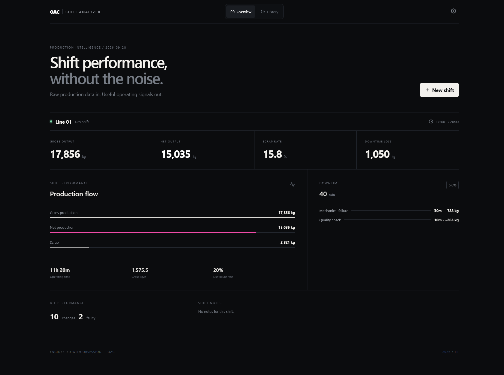

# Production Shift Analyzer

A lightweight, local-first tool for turning manufacturing shift data into useful operating signals.

**[Live Demo →](https://production-shift-analyzer.vercel.app)**



## Overview

Production Shift Analyzer turns basic manufacturing shift records into a clear view of production performance.

Enter gross and net production, die changes, faulty dies and downtime events. The application calculates the rest and presents the shift as a concise operational dashboard.

No account, database or external service is required.

### What it calculates

- Scrap quantity and scrap rate
- Actual operating time
- Gross production per operating hour
- Die failure rate
- Total downtime
- Estimated production loss caused by downtime
- Production loss by downtime reason

Completed shifts remain available in **History** for later review.

## ⏱️ Downtime loss

Downtime loss estimates how much production was lost while the line was stopped.

The calculation uses the actual gross production rate of the shift:

`Gross production rate = Gross production / Actual operating hours`

`Estimated downtime loss = Gross production rate × Downtime hours`

This is an operational estimate based on actual shift performance rather than a theoretical machine-capacity figure.

Downtime events are also separated by reason, making it possible to see where production time — and estimated output — was lost.

## 🛠️ Configuration

The analyzer can be adapted to different production environments without changing the code.

From **Settings**, users can manage:

- Shift duration
- Production lines
- Downtime reasons

Configuration is stored locally in the browser and immediately applied to the shift-entry workflow.

## Tech

- Next.js
- React
- TypeScript
- CSS
- Browser localStorage

The interface is built without a UI framework or charting library.

## ▶️ Run locally

Clone the repository:

```bash
git clone https://github.com/iamozdenalperencal/production-shift-analyzer.git
cd production-shift-analyzer
```

Install dependencies:

```bash
npm install
```

Start the development server:

```bash
npm run dev
```

Open:

```text
http://localhost:3000
```

For a production build:

```bash
npm run build
npm start
```

## 🔒 Data & privacy

Production data never needs to leave the user's browser.

Shift records and application settings are stored using `localStorage`. The application does not require a backend database for normal operation.

Clearing the browser's local storage will also remove saved shift records and settings.

## License

Released under the [MIT License](./LICENSE).

---

**engineered with obsession — OAC / 2026 / TR**